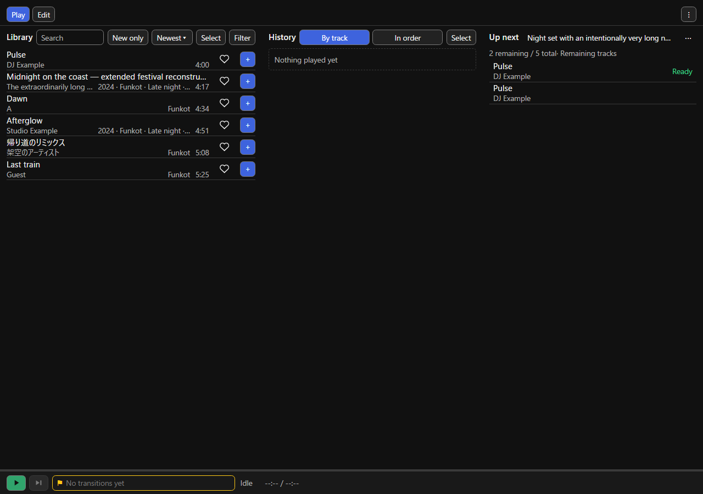
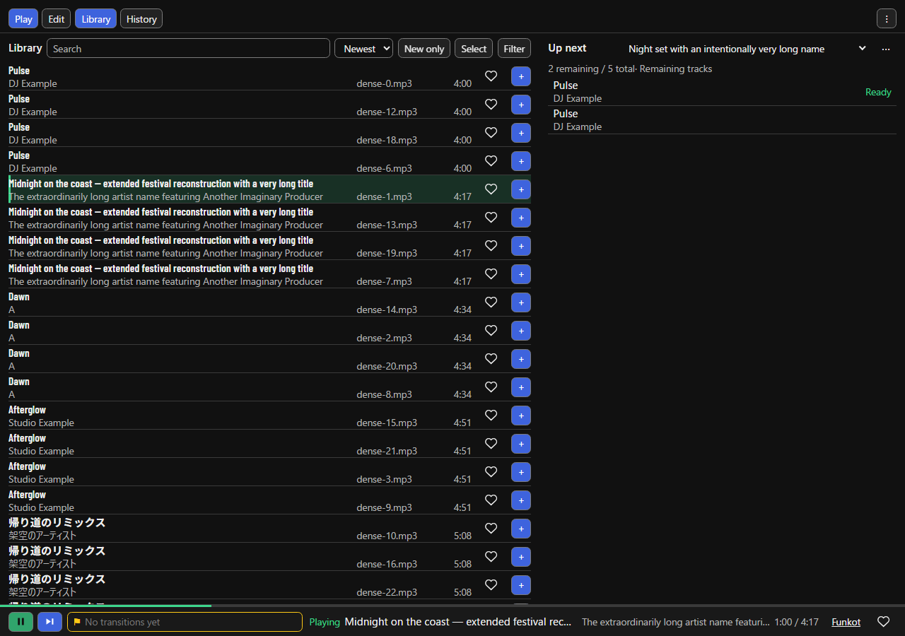
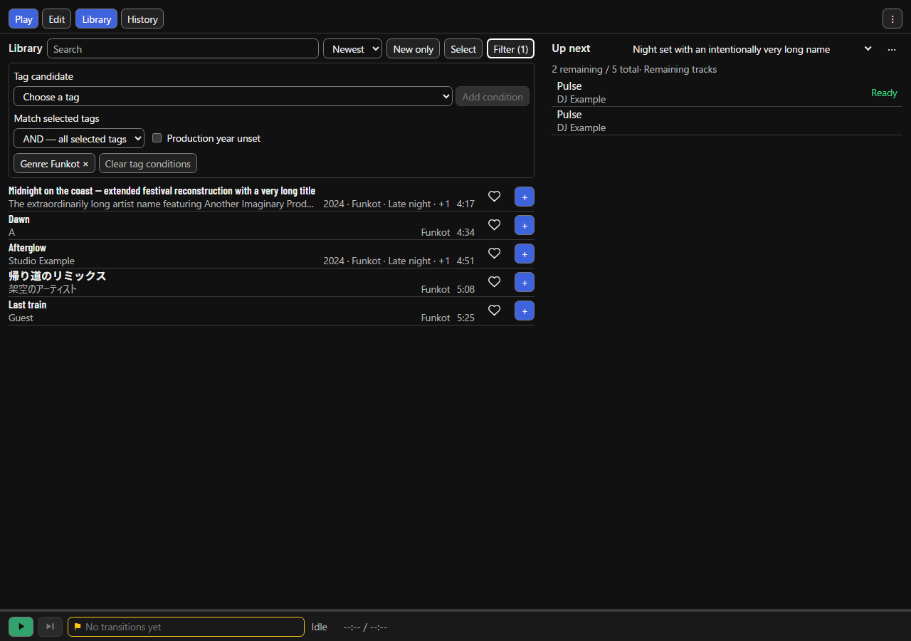
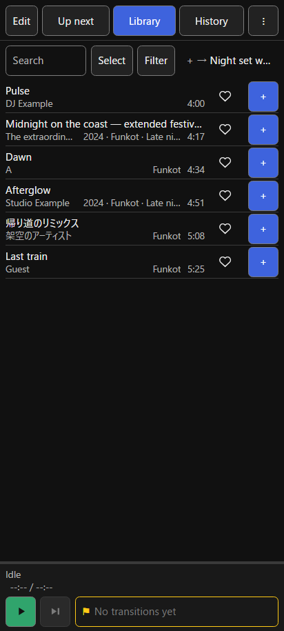
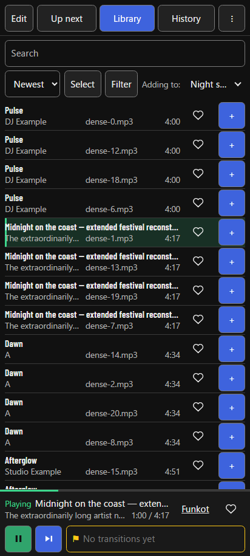
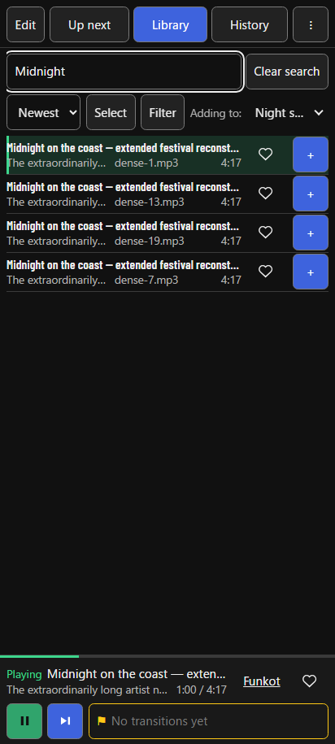
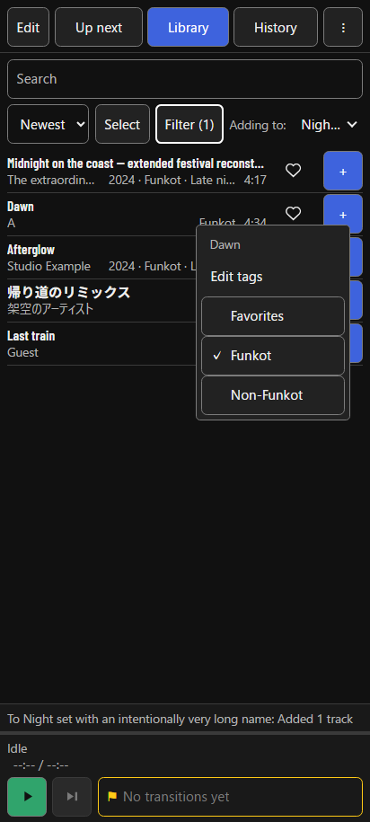

## Cursor — ライブラリを作業面にする

- エージェント: Cursor
- モデル: grok-4.7
- 起点: `df242795236b6413f0d3367f8af9966d3f685015`
- 提案: https://github.com/yasuyuki/funkot-player/commit/bb0c98047d3fc842db734e1ceec0d39bc54ff447
- ブランチ: https://github.com/yasuyuki/funkot-player/tree/proposal/library-ui-cursor
- 参照したスキル: インストール済みの `frontend-design`、リポジトリの `.claude/skills/ui-design/SKILL.md` と `docs/ui-design.md`
- 他エージェントのブランチやコメントは見ていません。`main` への統合もしていません。

### コンセプト

1280×900 の三列では、中身の履歴が空に近いのにライブラリ列が 453px まで細り、検索欄は 123px、長い曲名は 369/526px しか見えませんでした。探す・判断する・追加するの三つが、同じ画面で少ない幅を取り合っていました。

提案は、ライブラリと追加先（再生待ち）を横に残し、履歴は 1440px までタブに戻します。追加先は画面に一つだけです。狭い画面では検索を 1 行丸ごと使い、並び順を隠さない。再生中の曲は一覧に緑の背表紙として位置だけ示し、状態の文は下の再生バーに残します。曲名だけ Barlow Condensed（OFL）にし、操作の字体と寸法は今のトークンのままです。

配色は変えていません。別の色に塗り替えると再生待ちや手直しまで別の装置になり、この課題の報いは幅と判読性にあるためです。

### 画面

同じ synthetic fixture。提案の一覧は 24 曲に広げ、同じ曲名・アーティストにファイル名を出し、再生中の行を緑で示しています。

改修前 desktop 1280×900:

提案 desktop（長い曲名が最後まで読める）:

絞り込み desktop:

改修前 narrow 412×915:

提案 narrow:

検索 narrow:

行メニュー narrow（追加後のトーストに追加先のフルネーム）:

### 同条件の比較

密度は `tests/ui/density.spec.mjs` の 24 曲・同一 viewport。曲名の可視幅は fixture の長い曲名 1 件の clientWidth/scrollWidth。

| | desktop 改修前 | desktop 提案 | narrow 改修前 | narrow 提案 |
|---|---|---|---|---|
| 一覧の開始 | 88px | 88px | 116px | 167px |
| 行高 | 40px | 40px | 48px | 48px |
| 完全に見える行 | 19 | 19 | 14 | 13 |
| ライブラリ欄 | 453px | 739px | 396px | 396px |
| 検索欄 | 123px | 401px | 117px | 396px |
| 長い曲名 | 369/526（切れる） | 431/431（最後まで） | 289/526 | 289/431 |

操作数:

- 検索で目的の曲を見つける: 依然としてフィールド 1 つ。見える幅が desktop で約 3 倍、narrow では 1 行すべて。入力中は「検索を消す」が出ます。
- 並び順: 循環ボタン（次が何か押すまで分からない）を、新着順 / 曲名順 / アーティスト順が見える select にしました。narrow では以前、絞り込みを開くまで並び順が出ませんでした。今は常に出ています。
- 新着のみ: desktop は依然 1 押し。narrow は絞り込みパネルの中に入れました。開く手数は以前と同じで、置き場所だけ絞り込みと一緒にしました。
- 追加: 行の + は 1 押しのまま。クリックは playlist_command の append を 1 件送り、トーストにプレイリストのフルネームが出ます。desktop の追加先は右の再生待ち列。narrow は「Adding to:」と名前です。以前の `+ →` は外しました。
- 行の二次操作: 右クリック（タッチは長押し）でメニューが開き、タグ編集・お気に入り・Funkot 判定に到達します。Escape で閉じます。行ごとの常設メニューボタンは足していません。

### 変えたものと残したもの

変えたもの:

- 三列の境界を 72rem（1152px）から 90rem（1440px）へ。二列のライブラリ比を 1.2fr から 1.5fr へ。履歴は幅が足りるまでタブです。
- 並び順を select にしました。循環用の関数はテストのため残しています。
- 同じ曲名かつ同じアーティストの行は、二行目にファイル名を出します。曲名が空ならファイル名を曲名にします。
- 再生中の行に背景と左端の線。aria-current は true。
- 追加先ボタンの文字 ▾ を、対比が測れる形に替えました。

残したもの: 三帯、行からの直接追加、お気に入り、選択バー、タグの保存とキャンセル、再生元と閲覧の区別、マウス 28px / タッチ 44px、行の最小高さ、空・読み込み中・失敗の文言。未接続の操作はありません。

既存原則からの逸脱: 三列を遅らせたこと、狭いライブラリだけ一覧の開始を 51px 下げたこと、再生中の曲を再生バー以外にも位置として示したこと。曲名の書体だけ別フォントにしたこと。

### 検証

- `npm run check` 成功。
- `node --test src/lib/*.test.mjs` は 86 件成功。
- `npx playwright test`（desktop 1280×900 / narrow 412×915）は 129 成功、5 skip。失敗なし。検索、タグ絞り込み、行からの追加、行メニューと Escape、長い曲名の切れ方、表示行数を `tests/ui/proposal-library.spec.mjs` で確認しました。
- ブラウザ fixture です。WebView2 や Android 実機ではありません。
- `npm test` 全体には、この worktree の隣に `funkot-autodj-for-ui` が無いため失敗する音声検証スクリプトがあります。今回の画面変更とは別です。
- 再生中の緑の塗りは、再生していない通常画面の axe には入っていません。文字色は通常の本文色のままで、塗りは再生色を 16% 混ぜたものです。

### 採用を止め得る点

- 狭い画面で、完全に見える行が 14 から 13 に減ります。
- 1440px 未満では、履歴をライブラリと同時には見られません。
- 長いアーティスト名は、タグと並ぶと依然切れます。
- 狭い追加先は「Adding to:」のあとで名前が短く切れます。フルネームはトーストと accessible name にあります。
- 同名が多いと、ファイル名が二行目を埋めます。
