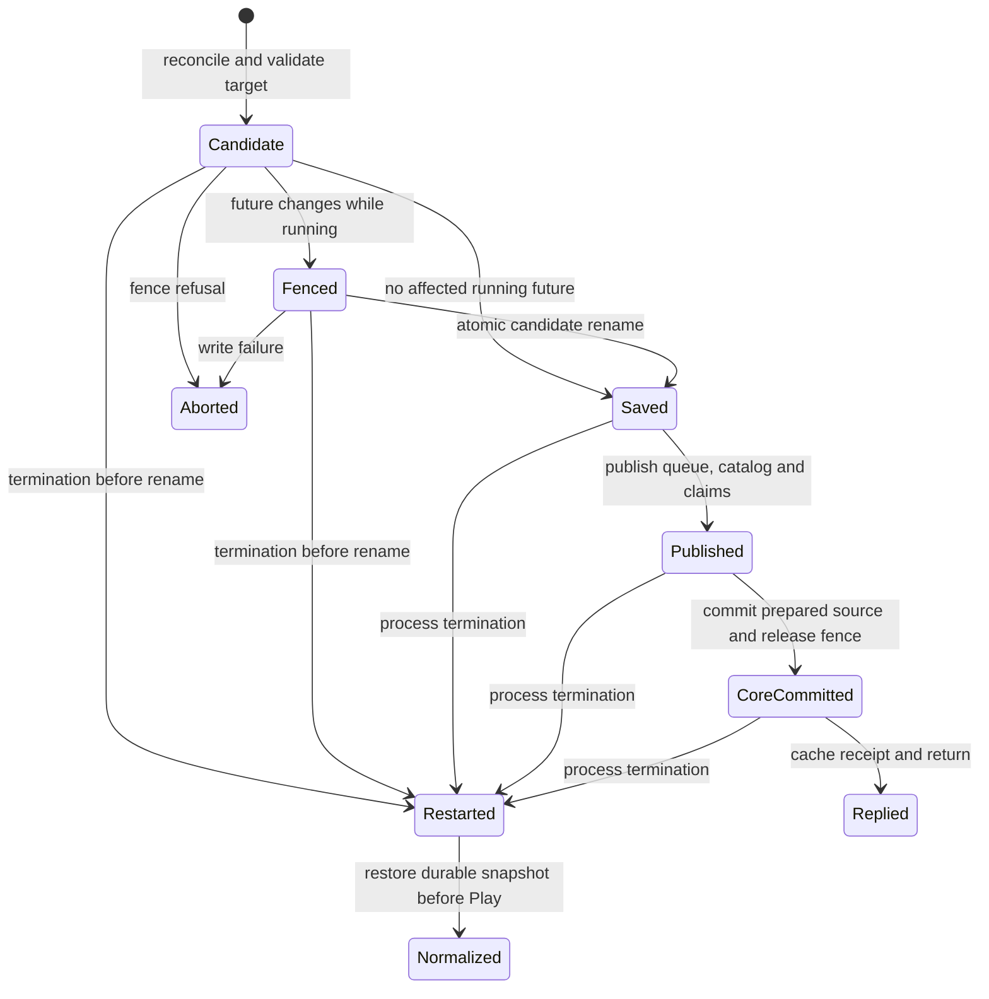

# Playlist occurrence progress

This check addresses [player #44's consumption contract](https://github.com/yasuyuki/funkot-player/issues/44#issuecomment-5841328990).
It directly imports `src-tauri/src/playlist_progress.rs`. Production
`Catalog::observe_progress` and the standalone driver call the same `observe`
function. No Kani branch substitutes the transition and no verifier dependency
enters Cargo or the Android APK.

## Run

Linux x86_64, Docker and cgroup v2 are required. From the player root:

```sh
./scripts/check-playlist-progress.sh --setup
./scripts/check-playlist-progress.sh /tmp/playlist-proof
```

Preparation builds a reusable image with Kani **0.68.0**, bundled Rust
**nightly-2026-08-21** (`1.100.0-nightly 8925ea358 2026-08-20`), CBMC **6.11.0**.
The Docker base's Rust 1.93 only builds the verifier launcher. The independent
Checks job caches this image and runs the same script; it needs no core sibling,
Android SDK, native build or UI. Evidence includes `kani.log`, `kani.json`, and
`summary.json` (wall time and cgroup peak memory). Verification has a total
15-minute deadline and 8-GiB container memory limit with no additional swap.
Unwinding, overflow, pointer and other default Kani assertions remain enabled.
Timeout, solver/unsupported reachability failure, absent harnesses or unreached
covers fail the check. Kani can warn about unsupported *unreachable* panic
machinery; reaching it must still fail verification.

## Property and scope

For any catalog occurrence and any progress state, a newly consumed
occurrence must have an accepted observation of the same playlist/run/entry and
engine index, or a reasoned unavailable/failed observation. Repeats are
idempotent; invalid observations leave progress unchanged. Valid observations
must progress, so replacing the implementation with a no-op fails.

- `occurrence_update` quantifies arbitrary before-state, optional registered
  target, optional engine claim and start/current/failure/unavailable/passive
  input. Run IDs are unrestricted `u64`, indices unrestricted `usize`, liveness
  and cancellation independent. There are no `kani::assume` restrictions on
  state or event order, including imported/restored failure flags.
- `initial_and_seven_occurrences` checks the empty initial state and independent
  updates to five occurrences plus another playlist's two. An observation can
  add at most one occurrence. This is a bounded non-interference check, not a
  seven-entry limit on the product. Both harnesses use unwind 8; unwinding
  assertions check that bound.
- Playlist and entry strings are represented by arbitrary `u8` equality IDs.
  The transition only uses equality, never arithmetic or string properties.
  The abstraction retains equal/different/absent/cancelled/old-run relations.
  Each invocation compares at most a target, claim and unavailable identity;
  256 distinct values are more than required to represent all such relations.
  The seven-entry case uses unique entry IDs, as required by `Catalog::validate`.
  Paths are deliberately absent: repeated A paths do not share entry IDs.
- Delayed starts of retired claims are valid; cancelled future claims are not.
  Source generation, loader epoch, run ID and engine index are separate in the
  production service. A source switch can preserve an old-source audible
  current. Generation is not used to reject it. The production integration
  tests exercise this mapping, preparation/lookahead, source switches, stale
  runs, restarts and failures.

The one-update consumption property holds for every input progress state.
Repeated serialized progress updates therefore preserve it regardless of
event/snapshot order. This is not an arbitrary-length
proof of every catalog edit: restart/resume can remove consumed membership, and
undo restores a removed occurrence's historical consumed/failure evidence only
within its original run. Existing Rust tests cover those operations.

## Production boundaries

The service's index-keyed claim map binds the exact occurrence returned by
`ManagedSource::next`; preparation alone changes no catalog progress. The
catalog adapter resolves membership/current run with ordinary collection lookups
and derives `reason_present` from a real, retained, nonblank reason. `observe`
checks the resulting identity against the claim and index and computes the
progress. The adapter and source cancellation/epoch behavior are covered by
normal Rust tests, not by a proof of the collection implementation.

Both the non-audition `TrackStarted` route and the authoritative
`Engine::current_index` snapshot route use this transition. The host publishes
current/finished together after main-engine rendering and control changes;
observers read that coherent snapshot without taking the render mutex. Native
regressions cover this publication boundary; Kani does not prove its concurrency.
Loader/gate failures also use the progress transition. Finished/exhausted, pending-empty, in-flight-empty and lifecycle
notifications do not create start evidence; the driver's passive input models
that absence of a progress update. A service call can apply a delayed event and
then a newer snapshot: these are two separately justified observations.

Real Engine integration tests connect emitted events/current snapshots to saved
progress and preserve other occurrences. The verifier trusts the meaning of an
Engine start/current observation. An incorrect producer can still lead to a
consumption that passes this proof. Threads, mutex ordering, Android lifecycle,
audio focus/output, DSP/clicks, and crash-safe file writes are outside this proof.
A proof PASS does not resolve the device failures or close #44.

For device click diagnosis, `playback diagnostics` logs render-lock misses and
their silent frame count, realtime preview-wait frames, and active preview-to-full
upgrade positions. The existing audio thread logs changes; the callback only
updates counters and publishes changed records. Upgrade `main_callback_frame`
is observed at the callback boundary. Finite captures separately record the
core's adopted `render_frame`, playhead and preparation evidence; replay uses
those engine positions and the actual preview/full recipe. These measurements
do not prove audible output quality and are outside the Kani model.
Replay compares the engine's preparation and preview-wait zeros as PCM. Only
unrendered transport padding is excluded; a transient during a wait is still
subject to the calibrated residual check.

The same runner checks sensitivity in isolated temporary copies. It changes
`Observation::Passive => None` to `Observation::Passive => Some(Cause::Started)`
and queue membership's `None => present` to `None => false`. Each named harness
must finish with a failing safety assertion. Compilation errors, missing results,
timeouts, and a mutation that passes fail the runner. The original five harness
names, cover counts, unwind bounds, and total deadline stay unchanged.
The summary records each mutation as `EXPECTED_FAIL` and hashes the unmodified
production source. These mutations do not identify a device failure's cause.

## Playback recovery

`verification/playback_recovery.rs` directly imports
`src-tauri/src/playback_recovery.rs`. The classifier proof represents each
legacy queue and catalog source as absent or as a sequence of zero to two
arbitrary `u8` equality IDs. It proves that an absent catalog keeps the queue,
an absent queue or equal sources use the catalog, and unequal present sources
return `Conflict`. The identity proof uses opaque `u8` IDs and proves that an
existing identity is retained for either origin, a playlist current is left
unchanged, and a missing normal current reuses its first matching identity or
creates one item exactly once.

The proof does not prove the caller's path and origin mapping from real
`QueueItem` values, legacy JSON decoding, snapshot persistence, filesystem
replacement, lock ordering, or service publication. Native recovery and
real-process interruption tests remain the authority for those behaviors.

The runner also changes the existing-identity guard and the unequal-source
`Conflict` branch in separate temporary copies. Each corresponding harness
must finish with a failing safety assertion. A compile error, timeout, or
passing mutation fails the run.

## Queue membership

`verification/queue_progress.rs` imports production
`src-tauri/src/queue_progress.rs`. `membership_update` quantifies an arbitrary
`u64` occurrence ID, before-membership, and every event variant. Only an
authorized add, automatic fill, delete, admission rejection, or accepted
playback start may change membership. Reservation, preparation rejection,
reordering, and passive events preserve it. Repeating an event is idempotent.
Its ten covers check both progress and preservation.

`distinct_occurrences` assumes two different arbitrary IDs and checks that one
event cannot change both. Its two covers require each occurrence to be
independently changeable. Equal audio paths do not merge occurrence IDs.
`automatic_fill_requires_exhausted_selection` checks that a usable unreserved
entry, an unsolicited request, or an inadmissible candidate prevents automatic
insertion. It has three covers. These three harnesses have no loops or
unwinding restriction.

These are per-occurrence transition proofs. They do not prove collection
lookups, snapshot serialization, multi-field transactions, filesystem
replacement, or recovery after termination. Persistence acceptance uses the
real-file restart and failure-injection tests in the native library suite.

The coherent playback snapshot commits through serialization, file replacement,
and a store mutex. Recovery reads the one authoritative file and rejects malformed
or conflicting identities. Issue #81's real-process termination, failed
commit/recovery, and identity-conflict tests check this boundary. The source-switch
model below assumes atomic old/new file replacement and checks the ordering around
it; it does not establish filesystem durability.

## Engine snapshot coherence

Kani still does not prove concurrent publication. `./scripts/check-engine-snapshot.sh` runs a Loom 0.7.2 check that a reader of `EngineObservation` observes one completed `(current, finished)` pair or nothing. The Kani harnesses, unwind bounds, and cover counts above are unchanged. The agent procedure is `.claude/skills/verify-engine-snapshot/SKILL.md`.

## Source-switch transactions and restart

[Issue #112](https://github.com/yasuyuki/funkot-player/issues/112) covers the
protocol between the playlist service, normal queue, loader, core future fence,
and coherent playback store. `source_switch/SourceSwitch.tla` is a finite
abstraction of this protocol. It does not import Rust. The native tests below
check its connection to the actual implementation; the existing Kani proofs
continue to import the pure occurrence and recovery decisions directly.

On Linux with Python 3.12 or later and Java 21, from a clean player checkout:

```sh
python3 -B -m unittest discover -s verification -p 'test_source_switch_result.py'
python3 -B verification/check_source_switch.py --setup
python3 -B verification/check_source_switch.py --output /tmp/source-switch-proof
cargo +1.93.0 test --manifest-path src-tauri/Cargo.toml --locked --lib
./scripts/check-release-invariants.sh
```

Select the working set before running. Outside a working set, put the official
core checkout in sibling `funkot-autodj-for-ui`. Its clean HEAD must exactly
match `funkot-core.commit`; a newer core is not substituted. The runner archives
both Git commits and checks the archived pin again. Missing or invalid revisions,
dirty tracked/index/untracked files in either member, a malformed working set,
a pin mismatch, unexpected tool bytes, timeout, incomplete exploration or an
undetected mutation produce FAIL. A nonempty output directory is refused without
changing old evidence. Use a new output directory for each invocation.

The runner fixes TLC 1.7.4 by SHA-256 and requires Java 21. The normal model must
finish with an empty work queue and no invariant violation. Three isolated cfg
variants must terminate with TLC exit 12 and their named invariant trace:

| Variant | Deliberate break | Required failure |
| --- | --- | --- |
| `stale_epoch` | Ignore service epoch at reservation/admission | `NoStaleLoaderEffect` |
| `missing_fence` | Publish an affected future without the core fence | `FenceBeforeFutureDelta` |
| `commit_after_failure` | Publish after a failed durable candidate write | `NoCommitWithoutDurableCandidate` |

Compile errors, tool failure and timeout do not count as detection. Read
`summary.json` and all four logs. The summary identifies both revisions, hashes
the modeled source and tool bytes, and records state counts, wall time and peak
child RSS. The whole verification has a 15-minute deadline. JVM `MaxRAM=8g` is a
sizing setting, not an enforced cgroup memory limit. CI's independent **Source
switch model** job runs this same entry and uploads the result even on failure.

### State and linearization

A saved file revision is distinct from catalog revision, catalog generation,
service loader epoch, core source generation, playlist run and engine index.
A source change can keep an old-source audible current. It invalidates future
work rather than consuming that current or a merely prepared occurrence.
Before Play, accepted queue/source edits fold recovered reservations into the
new pending order and retire their saved in-flight records in the same commit. A valid saved
current remains independently durable until resumed or explicitly retired.
Request receipts are process-local: an identical request replays its receipt
before target freshness is checked; a different fingerprint is stale. After a
crash, clients must read the restored target rather than assume an old receipt
survived. The model uses the committed target as an opaque receipt-result token;
the native replay test checks the actual result object. It does not prove JSON
serialization. A crash after rename and before reply can commit without a reply.



Termination before rename recovers the old file; termination afterward recovers
the candidate. In-process fence abort follows write failure. The model combines
failure and abort: the service lock prevents an intervening service update, and
callback/mailbox/crash actions commute with this local abort. This abstraction
does not introduce a fallible operation after a successful rename.

### Transition-to-code correspondence

| Model transition | Product path and native evidence |
| --- | --- |
| `Reserve`, `Capture`, `Admit` | `ManagedSource::next`, `HostSource::on_reserved`, `Service::normal_future_items`; local claim is registered before slow admission and checked again afterward. Same-path/different-ID Remove/Move tests cover both preparation windows. |
| `LoaderComplete`, `DeliverReady`, `CoreStart`, `CoreEnd` | Core loader and Engine track events; host callback publishes its coherent observation before delivering events. `real_engine_events_for_all_prepared_occurrences_are_consumed_by_index` and `delayed_started_event_consumes_its_occurrence_without_rolling_current_backward` cover the adapter. |
| `ObserveEvent`, `ObserveCurrent`, `ObserveEnd` | `Service::reconcile_with` and shared playlist/queue progress decisions. `real_engine_snapshot_keeps_old_audible_current_and_rejects_cancelled_future_event` checks exact occurrence and index. |
| `Begin`, `Fence`, `RefuseFence` | `command_with`, `reconfigure_admission`, core `begin_future_update`; target and observed current are rechecked. `source_fences_reject_an_engine_current_the_service_has_not_observed` and `source_switch_waits_for_initial_engine_control_handle` cover refusal. |
| `Rename`, `PersistFailure` | `PlaybackStore::update`/`persist_snapshot`, then `abort_future_update` on error. `source_switch_persist_failure_aborts_the_real_fence_without_retargeting_future` and stage-2 retry in `moving_a_registered_normal_future_retires_its_persisted_reservation` check complete rollback. |
| `Publish`, `CoreCommit` | Publish exact queue/catalog/session candidate, cancel affected claims, advance service epoch, commit prepared source. `real_source_switch_cancels_all_future_claims_and_retains_normal_order` checks their connection. |
| `Receipt`, `Reply`, `Retry`, stale target rejection | `command_with` receipt lookup, fingerprint and target checks. `request_receipt_replays_only_the_identical_source_and_revision_command` covers same request, changed payload/target and post-restart receipt loss. Rejection preservation is measured after reconciliation. |
| `Crash`, `RestartProcess`, `NormalizeStartup`, `NormalizeFailure` | Real subprocess cuts before and after rename in `source_switch_crash_cuts_recover_the_durable_current_without_silent_consumption`; `restore_saved_queue` from synchronous preload and again before Play. `failed_startup_restore_then_select_preserves_the_durable_normal_tail` checks failed preload followed by an accepted command. OFF retains a valid saved normal/playlist current via `failed_startup_restore_then_idle_off_retains_saved_current_before_play`; offline Move/OFF regressions check reservation retirement across reopening. `online_idle_off_before_first_loader_next_retains_playlist_current` covers configured control before the loader selects its first restore. |

### Finite scope and limits

The complete reachable graph has two sources, two initial occurrence identities
per source, one additional fresh normal identity, two transaction attempts, one
delayed future load per process, and one crash/restart. An initially audible
current can independently belong to either source. At most two normal items
coexist; all have the same queue priority. A raw source choice can requeue a
saved normal current with a fresh identity; an already admitted restoring claim
keeps its existing identity. Exact identity is independent of audio path.

The model includes source selection, active playlist restart, Move/Remove,
admission OFF/ON, delayed loader work, current/end observations, and receipt
replay with equal/different action, entry and target components. There is no
VIEW, symmetry quotient, state constraint or depth cutoff. It checks safety,
with no fairness or liveness claim. State counts describe this finite graph,
not all possible queues or event streams. Read the current cfg and summary for
the exact checked invariants and completed counts.

Transaction persistence may fail; progress and reservation persistence succeeds
in the model. The native tests remain necessary for failed progress saves,
actual collection lookups, disk serialization/validation, process locks, and
recovery errors. Legacy snapshots can contain the same normal current in
`catalog.current` and `session.in_flight`; that import overlap is outside the
model initial states. The Select regression checks its exact-ID retirement while
retaining a different same-path tail occurrence. Atomic file replacement is an assumption checked separately
by real-file tests, not an OS/power-loss theorem. Numeric wrap, mixed manual and
automatic priority, arbitrary queue lengths, multiple concurrent future loads,
unbounded crashes/requests, thread scheduling and startup control publication
are outside this model. The last boundary has a real busy-refusal regression.

This proof does not establish audio quality, click freedom, actual device output,
Android lifecycle, storage hardware guarantees, or the complete preview/full
lifecycle. It leaves the existing Kani and Loom jobs, native regressions and
release invariant checks in place. A model counterexample is a product bug only
after replay through actual Rust; wrong normalization, stale caller assumptions
or identity mapping are verification drift and must be corrected before PASS.
